# ActRaiser Recomp

**Play the full SNES ActRaiser campaign on your computer.** The Builder
recompiles the code from your USA ROM into a native game you can launch
directly. You can keep the original look, play in widescreen, or give the
action stages and towns depth with optional 3D views.

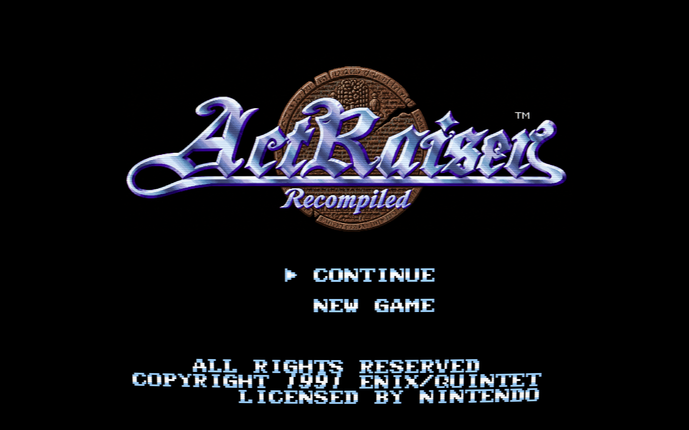

**[Download the Builder](https://github.com/DerrickGold/ar-recomp/releases)** ·
[Quick start](#quick-start) · [Features](#features) · [Quality of life](#quality-of-life) ·
[Project status](#progress-at-a-glance) ·
[Manual](docs/manual.md) · [Release notes](docs/release-notes.md) ·
[Build from source](#build-from-source) · [AI disclosure](#ai-disclosure)

[](https://github.com/DerrickGold/ar-recomp/releases)


## AI disclosure

Multiple AI coding assistants have contributed to the tools, runtime,
debugging, and documentation under my direction and review.

The Builder translates the original game's code from your ROM on your
computer. That generated code stays out of this repository. The widescreen
renderer, 3D views, settings, and other additions are original project work.

### Reverse-engineering notes

The [research notes](docs/actraiser-1/README.md) describe how the original
game works. They contain no ROM-derived code and may help people working
on an independent decompilation.

## Progress at a glance

| Area | Status | Details |
|---|---|---|
| USA campaign | ✅ Playable end to end | Playtesting covered all six towns, all twelve acts, Death Heim, and the ending. |
| Action stage graphics | 🔵 Mostly Done | Action stages in all six lands have their own environmental effects. I'm still extending artwork for widescreen and refining Diorama backgrounds, skyboxes, and Voxel rooms. |
| Desktop platforms | ✅ Major platforms tested | Windows, Apple Silicon macOS, and Steam Deck are playable. Builds are also available for Intel macOS and desktop Linux. |
| Android | 🟡 Preview | Build and install the preview from source. See [Android preview builds](docs/android.md). |
| Localization | ✅ Available | Create, share, and install translations through the Workshop. See [Language packs](docs/language-packs.md). |
| Regional rules | 🔵 Ready for more testing | US, Japanese, and European rules are implemented. More playtesting across campaigns and settings combinations is needed. |
| Decompilation | 🟡 In progress | I'm rewriting parts of the game in code that people can read and maintain, with the goal of matching the original behavior. |
| ActRaiser 2 | 📋 Full campaign planned | You can already [import its Master](docs/builder-workshop.md#actraiser-2-master) from your own ActRaiser 2 (USA) ROM and play as him in the first game's stages. |
| Achievements | 📋 Planned | — |

My long-term goal is to make this the definitive way to play ActRaiser. I'm
working toward separating game timing from rendering so a handheld could draw
fewer frames without slowing down gameplay. I'd also like to let players
travel between the two ActRaiser worlds during a campaign. A randomizer that
swaps stages between games is an idea for later.

## Quick start

You need your own unmodified **ActRaiser (USA)** cartridge dump. The Builder
checks it before building. The download includes the build tools, and the
build runs offline on your computer. You supply the ROM separately.

<details>
<summary>How to identify the USA ROM</summary>

| Field | Expected value |
|---|---|
| Internal title | `ACTRAISER-USA` |
| Size without copier header | 1,048,576 bytes (1 MiB) |
| Internal checksum | `0x83DB` |
| SHA-256 | `b8055844825653210d252d29a2229f9a3e7e512004e83940620173c57d8723f0` |
| SHA-1 | `e8365852cc20178d42c93cd188a7ae9af45369d7` |
| CRC32 | `0xEAC3358D` |

</details>

### 1. Download and open the Builder

Get the archive for your machine from [GitHub Releases](https://github.com/DerrickGold/ar-recomp/releases)
and extract it to a folder you can write to.

| Platform | Download | Open |
|---|---|---|
| macOS (Apple Silicon or Intel) | `ActRaiserRecompBuilder-macos-arm64-portable.zip` or `-macos-x86_64-portable.zip` | `ActRaiserRecompBuilder.app` |
| Windows (x64 or ARM64) | `ActRaiserRecompBuilder-windows-x86_64-portable.zip` or `-windows-arm64-portable.zip` | `ActRaiserRecompBuilder.exe` |
| Linux (x64 or ARM64) | `actraiser-recomp-linux-x86_64.tar.xz` or `-linux-arm64.tar.xz` | `./run-build.sh` to open the Builder in a browser |
| Steam Deck | `ActRaiserRecompBuilder-steam-deck-portable.tar.xz` | The Builder `.AppImage` in Desktop Mode |

Keep the portable Builder beside its `.portable` file. On first launch, the
Builder may take a few minutes to check and prepare its tools.

<details>
<summary>Troubleshoot Builder startup</summary>

- [macOS Gatekeeper](docs/desktop-packaging.md#macos-gatekeeper)
- [Windows WebView2](docs/desktop-packaging.md#windows-webview2-runtime)
- [Windows Application Control](docs/desktop-packaging.md#windows-application-control)
- [Linux AppImage startup](docs/desktop-packaging.md#inspecting-paths-and-troubleshooting)

</details>

### 2. Choose a game folder and build

The desktop Builder asks where to put the game. It suggests an
`ActRaiserRecomp` folder next to the Builder. Open **Build & play**, select
your USA ROM, and click **Build game**. You can explore the Workshop while
the build runs.

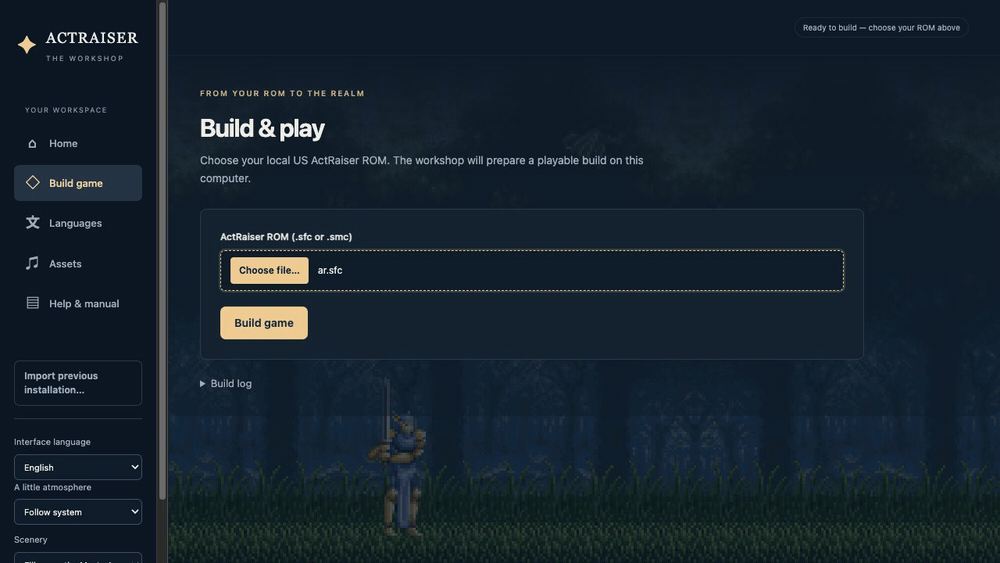

### 3. Play

Select **Run game** when the build finishes. After that, you can launch the
game directly: open `ActRaiserRecomp.app` on macOS, `ActRaiserRecomp.exe` on
Windows, or `ActRaiserRecomp.AppImage` on Linux and Steam Deck. On Windows,
keep the executable and the rest of the game folder together.

Press **Esc** or **F1** on the keyboard, or **L3** on your controller, to open
settings. See the [controls guide](docs/manual.md#controls) to change bindings.

### 4. Update or import an existing installation

Use **Check for updates** in the Builder sidebar to find newer downloads.

> [!IMPORTANT]
> Close the game and back up your `saves/` folder before rebuilding.

Open the newer Builder and build into your existing game folder. Your saves,
settings, language packs, and custom assets carry over. If the update
replaces bundled Diorama scenery, it keeps a backup of your previous edits.
For per-user macOS or Linux installs, replace the generated app and keep your
existing data folder.

If you're moving from another installation, use **Import previous
installation…** in the Builder before you launch the game. On first launch,
the game checks its selected data folder for older saves. It imports an old
save automatically into **Slot 1** and keeps the original files in
`saves/legacy-layout/`. Choose **Continue** to resume. See
[Upgrading older saves](docs/manual.md#upgrading-older-saves).

### 5. Keep the game after building

You can keep playing without the Builder. To move a portable game, copy the
whole game folder, including any `.portable` file. On macOS or Linux, copying
just the game app or AppImage without that file uses per-user storage. Copy
your saves and settings separately if you're switching storage modes.
See [where your game stores its data](docs/desktop-packaging.md#portable-and-per-user-storage).
The game you build contains data from your ROM and is for your own use.

## Features

### Widescreen

See more of the stage at 16:9 or 16:10. The game draws beyond the original
screen edges, so backgrounds still scroll at different speeds and enemies
can appear in the extra space. **Auto** fits the view to your window. In
action stages it adds side bars on displays wider than 16:9.

With widescreen set up, press `F9` to cycle between original 4:3, raw
widescreen, and full widescreen with a separately scaled HUD.
[Display shortcuts](docs/manual.md#host-hotkeys)

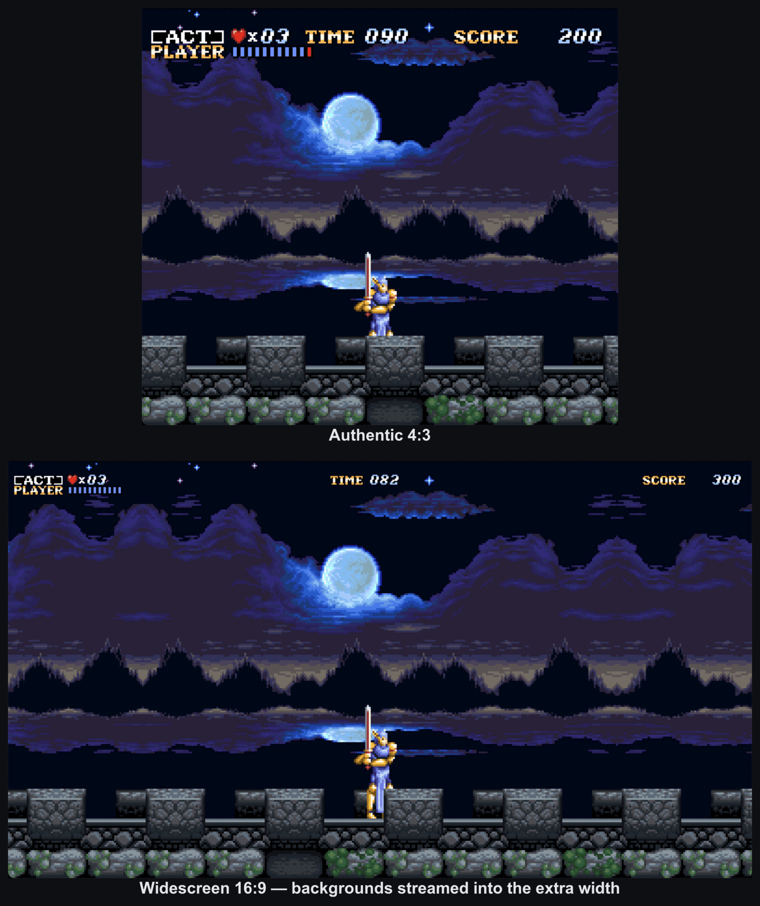

### Diorama and Voxel 3D for action stages

<a name="diorama-3d-for-action-stages"></a>

Open **Action 3D → Scene → Action 3D** to choose how the stages look:

| Mode | What you'll see |
|---|---|
| **Off** | The original flat view. Widescreen still works. A fresh installation starts here. |
| **Diorama** | Backgrounds and sprites sit on separate layers. The camera can tilt and pull back to show the space between them. |
| **Voxel 3D (WIP)** | Supported rooms have modeled floors, ramps, doorways, and selected objects. They keep the original artwork and gameplay. Other rooms use Diorama. |

Diorama is the default 3D option. **Dynamic Cam** moves with the action.
**Free Cam** lets you orbit and zoom, and keeps the room centered when you
zoom far out. Switch back to Diorama to use your saved background and layer
settings. See [Action 3D modes](docs/manual.md#action-3d-modes).

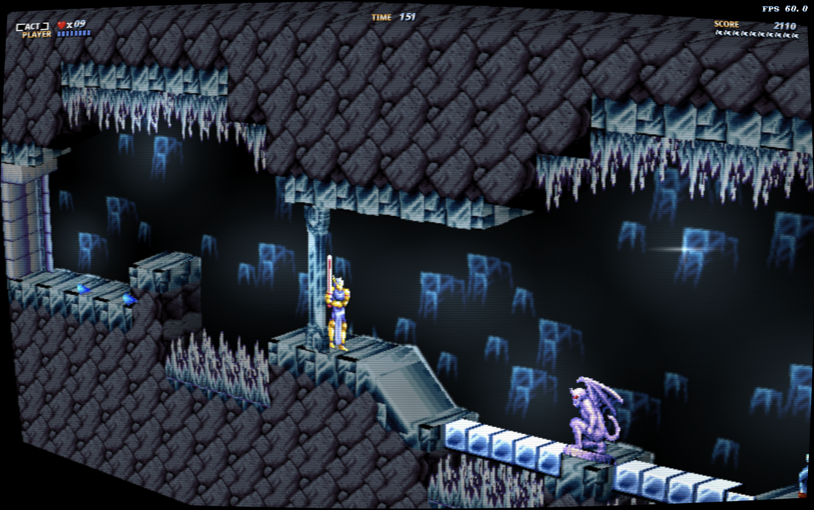

**Voxel 3D** in Northwall's ice caves.

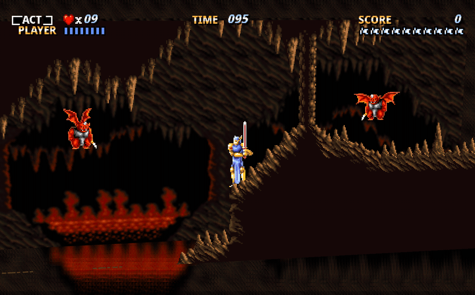

**Diorama** in Aitos Act 2.

In Diorama and Voxel 3D, turn on **Environmental effects** to add glow and
drifting dust to Death Heim's final battle. The **Death Heim completion scene**
setting under **Action 3D → Scene** adds an ocean vista to the ending and works
with any skybox setting. [Death Heim visuals](docs/manual.md#death-heim-final-battle)

### GPU and CRT effects

Many **Environmental effects** work in both flat and 3D views. Watch mist drift
over Bloodpool's marsh, lava light the rock in Aitos, and snow blow across
Northwall. Some effects use the 3D view, including Northwall's aurora and the
extra lava bubble animation in Aitos. See the
[stage guide](docs/actraiser-1/action-environments.md).

Use **Action spell lighting** and **Action spell particles** to adjust magic
effects separately from the scenery.

In **Video → General**, use **Render resolution** to choose **Native** or
a preset from **480p** to **2160p**. **3D anti-aliasing** smooths jagged edges:
try **FXAA** for a lighter filter or **SMAA** to keep more detail around corners.
**3D supersampling** lets a higher preset draw above the size of the game view,
then shrink the image. It takes more GPU time and uses its own filter in place
of FXAA or SMAA while active. Both options start off and apply to 3D scenes,
leaving the flat HUD and menus alone. See [Display and scaling](docs/manual.md#display-and-scaling).

Under **Video → CRT**, you can add scanlines, curved glass, and a phosphor mask.
Diorama also offers depth of field, rim lighting, and optional frame
interpolation for smoother motion on high refresh rate displays.

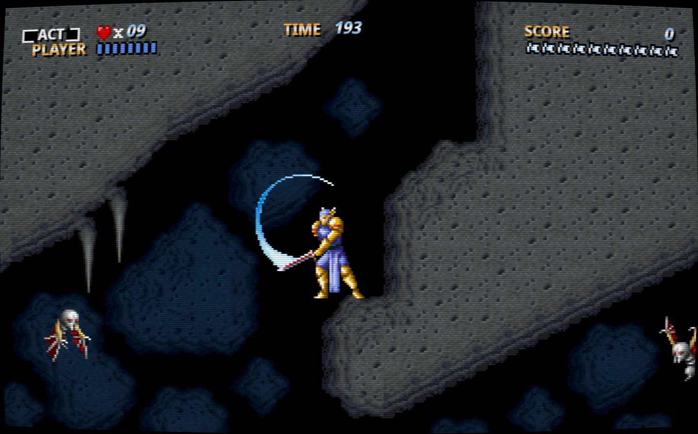

### 3D simulation towns

Tilt the town map and see hills, buildings, and bridges rise from the ground.
You can still place buildings and aim miracles in the tilted view. The optional
3D church shows the town through its windows during audiences and offerings.

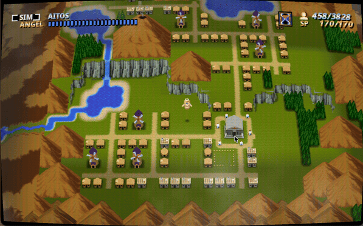

### 3D world navigation

Fly the Sky Palace over a globe with mountains, clouds, and the towns you've
built. You can turn the camera and zoom in for a closer look. The original menus
still handle travel and town entry. With **Sky Palace globe backdrop** enabled,
you can also see the globe behind the Palace pillars and menus.
See the [camera controls](docs/manual.md#camera-control).

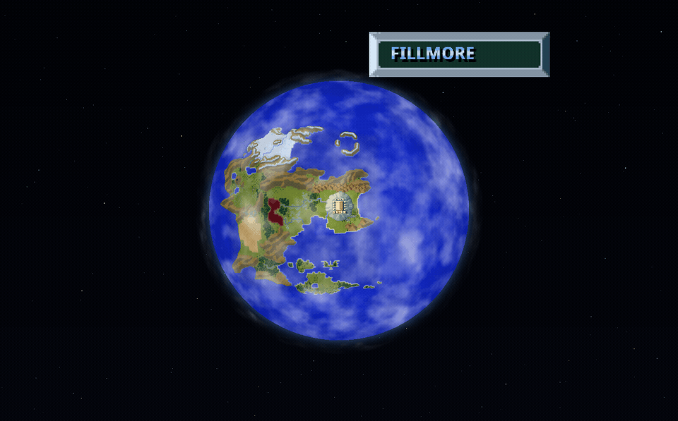

### Live authentic comparison

Bind **Compare rendering** under **Settings → Controls**. A quick press
switches to or from the original SNES picture and sound. Hold the button to see
the original picture as an inset while you keep playing in the enhanced
view. Hold it again to close the inset.

Under **Video → General**, you can move the inset to any corner. On desktop,
**PiP separate window** puts it in its own window. Resize it or make it
fullscreen on a second monitor. Close that window to return to the inset.
See [comparison controls](docs/manual.md#authenticenhanced-comparison-control).

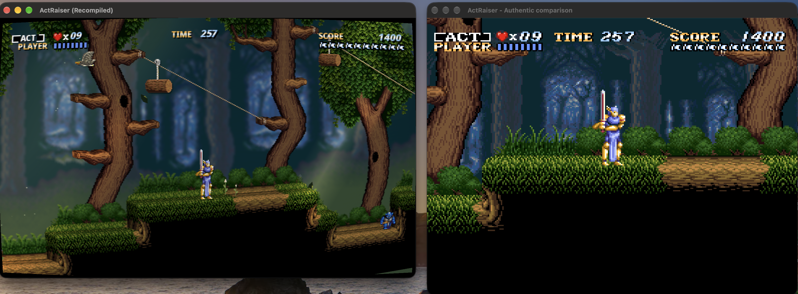

**Separate window.** Enhanced gameplay on the left and the original SNES view on the right.

<details>
<summary>See the picture-in-picture example</summary>

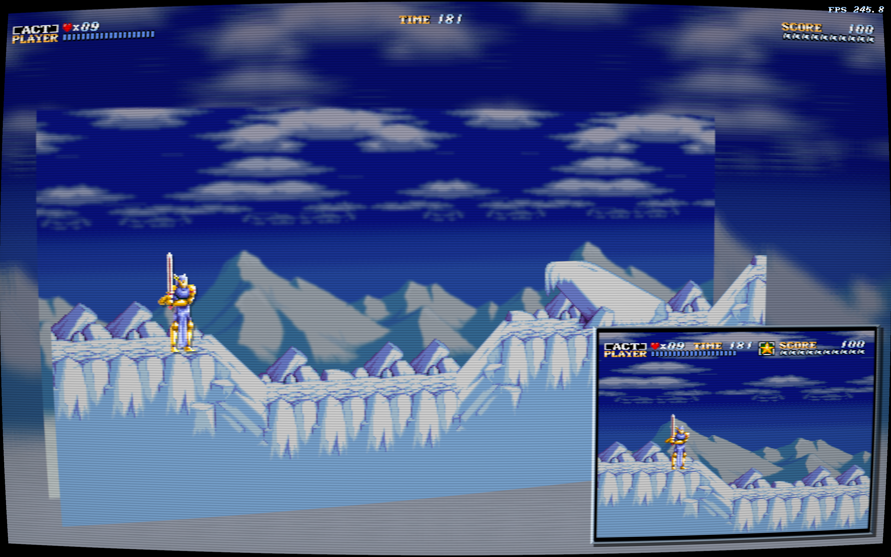

</details>

### Quality of life

#### Gameplay and town menus

<details>
<summary>Boss rush, character switching, and town menu options</summary>

| Feature | What you can do |
|---|---|
| **Death Heim boss roster** | Before the final boss, fight the six Act 2 bosses, swap in the six Act 1 bosses, or take on all twelve. [Boss rush guide](docs/manual.md#death-heim-boss-rush) |
| **Death Heim boss order** | Shuffle the selected roster with a seed saved to your campaign. Find the controls under **Randomizer → Bosses** after enabling debug settings. [Boss order settings](docs/actraiser-1/randomizer.md#death-heim-boss-order) |
| **ActRaiser 2 Master** | Switch characters during an ActRaiser stage after importing the winged Master from your own ActRaiser 2 (USA) ROM. [Import instructions](docs/builder-workshop.md#actraiser-2-master) |
| **Remember last town** | Start over the last town you visited when you choose **Continue**. This is on by default. |
| **Bridge-free limit** | Keep completed bridges out of the 128-structure cap, including in existing towns. Bridges still let people cross and support 32 residents each. |
| **Native menu quick use** | Skip optional explanations when you choose **Use** in the original town menu. Confirmations and outcomes still play as usual. [Town menu guide](docs/manual.md#native-sim-menu-quick-use) |
| **Modern town menu** | Browse town commands by category and return to your last selection. Works in flat and 3D towns. [Modern SIM menu](docs/manual.md#modern-sim-menu) |
| **Describe menu item** | Use a rebindable control to read a command without using it in the modern menu, or run the full original flow when Native menu quick use is on. |
| **Town menu size** | Scale the modern town menu independently from 50% to 100%. |
| **Pause** | Press `P` or bind a controller button to pause and resume. |
| **Turbo multiplier** | Toggle fast-forward with `T` or a controller binding. Choose 2–64 game frames per rendered frame. The default is 8. |
| **Correct Aitos messages** | Prevent overlapping events from showing the wrong town message. |
| **Wind stops every windmill** | Keep newly built windmills still during Aitos's no-wind event in the enhanced town view. |

Find the boss roster, character switch, bridge limit, last-town option, quick
use, and turbo speed under **System → Game → Quality of life**. The same menu
has a section for fixes to the original game. [Enhancements](docs/manual.md#enhancements)

</details>

#### Controls and interface

<details>
<summary>Controller bindings, twin-stick shooting, and camera controls</summary>

| Feature | What you can do |
|---|---|
| **Rebindable controls** | Set keyboard and gamepad bindings separately. Keyboard bindings follow physical key positions when you change layouts. |
| **Gamepad selection** | Pick a connected pad or follow the first connected pad as devices are plugged in and unplugged. Use `gamecontrollerdb.txt` to add SDL controller mappings. |
| **Controller shortcuts** | Bind settings, pause, fast-forward, camera reset, and rendering comparison to controller buttons. |
| **Stick as D-pad** | Use the left stick for digital movement and adjust how far it must move before it counts as a direction. |
| **Analog angel movement** | Fly in any direction in towns, vary speed with the left stick, and adjust the angel's own deadzone. |
| **Twin-stick shooting** | Bind **Shoot up**, **Shoot down**, **Shoot left**, and **Shoot right** to fire independently of movement in towns. |
| **Camera controls** | Orbit with the right stick or right-drag, zoom with triggers or the wheel, and recenter with R3 or middle-click. Adjust sensitivity, deadzone, and vertical inversion. |
| **Free Cam framing** | Keep manually controlled action scenes framed near room edges and centered when zoomed out. [Camera control](docs/manual.md#camera-control) |
| **Steam Deck controls** | Use Steam Input or the built-in pad in Desktop Mode. L3 opens settings. [Steam Deck controls](docs/manual.md#steam-deck) |
| **Android touch controls** | Rebind the preview's on-screen buttons. They hide when a physical controller is connected. [Android controls](docs/android.md#playing) |
| **Xbox One USB on macOS** | Use an original Xbox One controller over USB in a macOS source build. Set `AR_XBOX_USB_ROOT` to the separate bridge module when configuring CMake. [Build from source](#build-from-source) |
| **Settings overlay** | Open settings with `Esc`, `F1`, or L3, including after the ending. Changes save automatically, and you can reset defaults by section. |
| **In-game manual** | Install your manual through the Workshop and read it from the settings overlay. [Install your own manual](docs/builder-workshop.md#install-your-own-manual) |
| **Enhanced text** | Adjust font size, choose Crisp or Smooth rendering, or give enhanced text a low-resolution pixel look. [Language packs](docs/language-packs.md) |

See the [controls reference](docs/manual.md#controls) and the
[settings overlay guide](docs/manual.md#the-settings-overlay).

</details>

#### Saves and recovery

<details>
<summary>Campaign slots, save editing, transfers, and backups</summary>

| Feature | What you can do |
|---|---|
| **Ten campaign slots** | Preview character level, completed acts, and save time. Each slot keeps its own regional rules, randomizer setup, and character name. |
| **Campaign import and export** | Move saved progress and campaign settings between slots or installations with a complete `.arsave` archive. |
| **Raw saves** | Import or export SRAM for emulator use or lossless INI for tools. Choose either format when creating a new slot. |
| **Save editor** | Inspect and edit town progress, unlocks, character stats, magic, items, and scores. Confirm changes to the active slot before applying them. |
| **Automatic backups** | Keep a copy of the previous campaign before the first saved edit or import in a session when backups are enabled. |
| **Save recovery** | See when a slot's save is missing or damaged and use **Import save** to restore a backup. |
| **Restart in the same window** | Switch slots, apply save edits and restart, or restart from the menu. Save with the **Progress Log** before switching slots. |
| **Automatic import of older saves** | The first launch in an older data folder adopts your save into Slot 1 and keeps the originals. [Upgrading older saves](docs/manual.md#upgrading-older-saves) |

See [Save slots](docs/manual.md#save-slots) and the
[Save editor](docs/manual.md#save-editor) for details.

</details>

#### Display

<details>
<summary>Resolution, edge smoothing, and comparison windows</summary>

| Feature | What you can do |
|---|---|
| **Screen ratio** | Choose 4:3, 16:9, 16:10, or Stretch. |
| **Automatic screen ratio** | Fit the game view to the window as you resize it. Action stages cap at 16:9 in Auto. |
| **Pixel aspect** | Choose the original CRT pixel proportions or square pixels. |
| **Window mode** | Play in a window, borderless fullscreen, or exclusive fullscreen. |
| **Render resolution** | Use **Native** or a preset from 480p to 2160p for flat and 3D views. |
| **3D anti-aliasing** | Smooth jagged edges with the lighter FXAA filter or use SMAA to preserve more corner detail. |
| **3D supersampling** | Draw 3D scenes at a higher resolution and shrink them to fit for smoother edges. This takes more GPU time. |
| **Refresh rate** | Choose Vsync, Uncapped, a custom FPS limit, or Unlimited. |
| **Graphics API** | Choose a graphics API and restart to apply it. The game falls back to Automatic if the selected API can't start. |
| **FPS counter** | Check how many frames the game displays each second. |
| **Performance overlay** | Inspect frame timing while you play. [Performance overlay guide](docs/performance-overlay.md) |
| **Widescreen HUD size** | Resize the separate widescreen HUD from 25% to 400%. |
| **Settings menu size** | Fit the menu automatically or resize it independently, up to 800%. |
| **Live authentic comparison** | Switch between the original SNES presentation and the enhanced view, or show the original picture as an inset. |
| **Picture-in-picture corner** | Move the inset to any corner. |
| **Separate comparison window** | Open the original view in a resizable desktop window. |
| **Comparison fullscreen** | Put the separate view fullscreen on another monitor while keeping the main game in its own window mode. |

See [Display and scaling](docs/manual.md#display-and-scaling),
[graphics settings](#gpu-and-crt-effects), and
[Live authentic comparison](#live-authentic-comparison).

</details>

#### Audio

<details>
<summary>Volume, dialogue sounds, and replacement music</summary>

| Feature | What you can do |
|---|---|
| **Independent volume controls** | Set master, music, and sound-effect volume separately, or mute all output. |
| **Dialogue text blip** | Mute the sound that plays as Sky Palace dialogue appears. |
| **Extended sound channels** | Keep all eight music voices and add 32 voices for sound effects. |
| **Audio frequency** | Match the device rate automatically or choose a fixed rate. SDL uses at least 44.1 kHz for output. |
| **Audio buffer size** | Adjust the audio buffer and restart to apply it. |
| **Enhanced music** | Switch between original and replacement music while a song is playing. |
| **Replacement music fades** | Hear replacement tracks fade at the original game's pace during transitions, including boss entrances. |

See the [audio settings](docs/manual.md#audio) and
[music and artwork replacements](#asset-and-music-replacements).

</details>

#### Randomizer

<details>
<summary>Seeded campaigns, enemy shuffles, and item rolls</summary>

The experimental campaign randomizer appears at the title screen with **Show
debug settings** enabled. Full randomized campaigns still need playtesting.
[Seeded campaigns](docs/actraiser-1/randomizer.md)

| Feature | What you can do |
|---|---|
| **Seeded campaigns** | Use the same seed and settings to reproduce a campaign's rolls. Your save remembers the recipe. |
| **Regional rule rolls** | Roll US, Japanese, or European rules separately for action stages and towns. |
| **Enemy shuffle** | Shuffle enemy types on a map or across an act. |
| **Enemy health** | Scale enemy health for a seeded campaign. |
| **Enemy damage** | Scale damage from enemy contact and attacks. |
| **Statue drops** | Shuffle existing rewards or roll new ones for breakable statues. |
| **Statue placement** | Shuffle breakable statues among their existing positions on a map. |
| **Monster lair positions** | Shuffle the lairs among their existing locations in each town. |
| **Monster lair types** | Change which monster each lair spawns. |

</details>

#### Cheats and practice tools

<details>
<summary>Invulnerability, spell controls, and level warp</summary>

| Feature | What you can do |
|---|---|
| **Infinite action health** | Keep the Master’s health full in action stages. |
| **Infinite magic scrolls** | Keep magic scrolls available during action stages. |
| **Infinite miracle points** | Keep SP full in towns. |
| **Infinite angel health** | Keep the angel's health full in towns. |
| **No knockback** | Prevent damage, knockback, and hitstun during ordinary play. |
| **Freeze timer** | Stop the action timer. The boss clear countdown can still have issues with this cheat. |
| **Moonjump** | Hold jump to fly upward and adjust the climb speed. |
| **Ranged sword** | Fire a projectile with a sword swing. |
| **All magic** | Unlock all four spells. |
| **Cycle magic spell** | Use a rebindable control to cycle through unlocked spells during a stage. |
| **Custom Pro Action Replay codes** | Apply your own supported codes. |
| **Level warp** | Jump to a known room for testing from the debug tools. |

See [Cheats](docs/manual.md#cheats) and [Level warp](docs/manual.md#level-warp).

</details>

### Action scene and effects editor

Use the offline [action editor](tools/action_editor/README.md) to paint tiles,
extend a room for widescreen, or change how its layers and effects look.
In the Voxel preview, click a tile or a whole object. Try changes to its
shape or artwork before applying them together. **Save project** keeps
your scenery and effects in one archive. The guide explains how to load
the edited room in your game.

### Asset and music replacements

In the Workshop, replace the title logo or pick your own music for a stage.
The title art can follow the original Mode 7 rotation and zoom at higher
resolution. Preview the original tracks from your ROM in the Workshop, then
choose your own OGG files and set loop points if needed. **Split by level**
lets Bloodpool and Kasandora use different files even when they share an
original song. The original sound effects still play.
[Workshop guide](docs/builder-workshop.md) · [Music loop settings](docs/manual.md#music-musicname-entries-files-under-game-assetsaudio)

### Languages and enhanced text

Install a translation in the Workshop and select it under **Settings →
Localization**. You can also use the Workshop to check how your own translation
looks in the game and export it as an `.arlang` pack for others to install.
You can adjust font size and use fallback fonts for characters your main font
lacks. The original US text remains available with its original font.
See the [language pack guide](docs/language-packs.md).

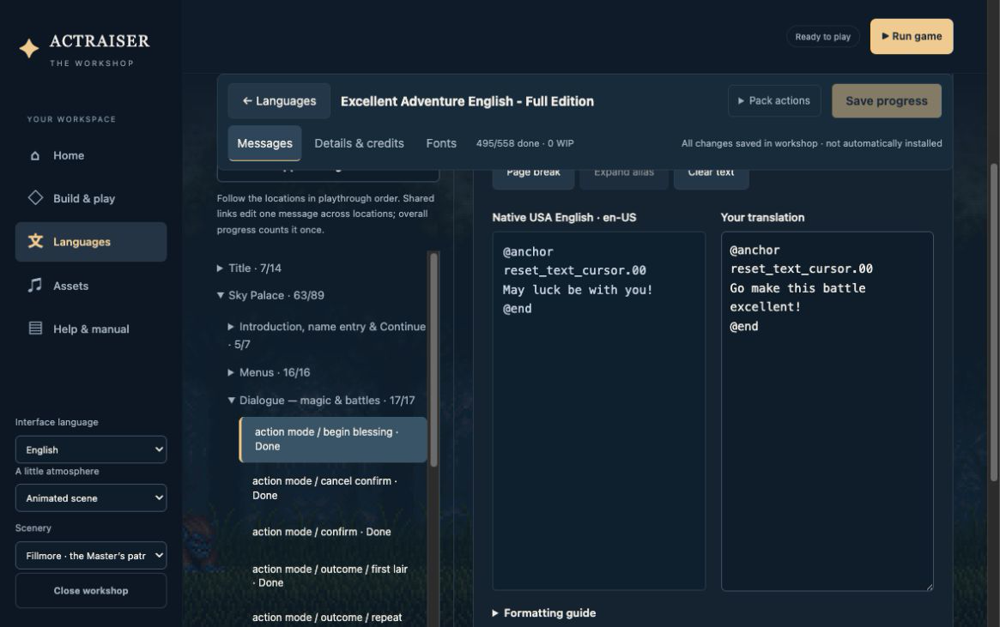

### Regional rules, artwork, and music

Build with the USA ROM, then open **Settings → Regions**. Choose US,
Japanese, or European rules, or mix them. For example, you can use US stages
with Japanese boss behavior. Your campaign remembers its choices. The USA ROM
is enough to use the gameplay rules. To add regional art and music from your
own regional ROMs, use **Assets → Regional media** in the Workshop. Your text
language is a separate choice.
See [regional rules](docs/actraiser-1/regional-settings.md) and
[regional artwork and music](docs/actraiser-1/regional-media.md).

## Development

### Build from source

Install Go 1.25 or newer, CMake 3.25 or newer, GNU Make, a C/C++ compiler,
and the development libraries for SDL3 3.4+ and SDL3_ttf 3.2+. On macOS you
can use the Xcode Command Line Tools. On Windows, use a native compiler and
a shell with Make.

From the repository root:

```sh
make dev ROM=/absolute/path/to/your-usa-rom.sfc
./build-release/ActRaiserRecomp /absolute/path/to/your-usa-rom.sfc --config config.ini
```

`make dev` generates the game code if needed, builds the optimized
`play` preset, and creates `config.ini` if it doesn't exist. You can omit
`ROM=…` if your ROM is named `ar.sfc` at the repository root. To rebuild
after editing C or C++, run `cmake --build --preset play`.

See [Android preview builds](docs/android.md) for the debug APK and
[desktop packaging](docs/desktop-packaging.md) to package a game or Builder.
To split release builds across machines, use
`make release-remote build-host other-host localhost` with your own SSH
aliases. See [remote builds](docs/desktop-packaging.md#packaging-across-build-hosts).

### Layout and testing

The recompiler translates the USA ROM's 65816 machine code into C on your
machine. That code lives in `src/gen/` and stays out of the repository.
`src/` contains the runtime and game enhancements. `installer/` contains the
Builder, Workshop, and packaging. `snesrecomp-go/` contains the shared recompiler
and build tools. `snesbuild.ini` lists the runtime sources for local and
packaged builds.

| Preset | When to use it |
|---|---|
| `play` | Build an optimized game in `build-release/` to play locally. |
| `dev` | Run tests or record diagnostics from a Debug build. |
| `trace` | Include generated CPU instrumentation when you need a detailed trace. |
| `asan` | Check memory errors and undefined behavior. |
| `control` | Compare performance with an optimized build that uses flat town terrain. |

See [Contributing](CONTRIBUTING.md) for setup. Run `make check-quality` to
check the source or `make check` to run the full set of ROM-free checks.
Recorded gameplay replays let developers compare game state and performance.
See the [benchmark definitions](tools/runner-bench.json) for details.

[How emulation, recompilation, and decompilation differ](https://derrickgold.github.io/emu-recomp-decomp/)

## Documentation

- **Play or update:** [Player manual](docs/manual.md),
  [release notes](docs/release-notes.md), and [desktop packaging](docs/desktop-packaging.md).
- **Make something:** [Workshop](docs/builder-workshop.md),
  [action editor](tools/action_editor/README.md), and [language packs](docs/language-packs.md).
- **Find a reference:** [Documentation index](docs/README.md),
  [ActRaiser 1 research](docs/actraiser-1/README.md),
  [Builder development](installer/README.md), and [recompiler development](snesrecomp-go/README.md).

## License

The repository's original source, including the runtime, tooling,
`recomp/*.cfg`, and documentation, is [MIT-licensed](LICENSE). This license does
not cover the ActRaiser ROM or material derived from it; the Scope section of
the license defines the boundary.

The Go implementation, tooling, tests, documentation, and project-authored
portable C runner under `snesrecomp-go/` use a separate
[MIT license](snesrecomp-go/LICENSE). Its slot-accurate S-DSP contains
adaptations from the MIT-licensed Snaggletooth project. The exact scope,
historical lineage, and retained third-party notices are documented in
[`snesrecomp-go/LICENSE_SCOPE.md`](snesrecomp-go/LICENSE_SCOPE.md),
[`snesrecomp-go/ATTRIBUTION.md`](snesrecomp-go/ATTRIBUTION.md), and
[`snesrecomp-go/THIRD_PARTY_NOTICES.md`](snesrecomp-go/THIRD_PARTY_NOTICES.md).
ActRaiser Builder resources and game-distribution dependencies are documented
separately in
[`installer/THIRD_PARTY_NOTICES.md`](installer/THIRD_PARTY_NOTICES.md).
